# Walkthrough: when do SGD, AdamW and Muon split?

**[planned]** = in the project plan. **[extra]** = added after seeing the results.
Status: all runs and analyses done (103 GPU-hours on L40S, 392 runs).
Checkpoint (2 pages, for the class): `checkpoint.pdf`. Full write-up: `report.pdf`.

## TL;DR

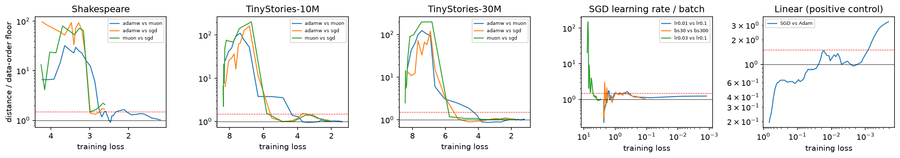

*Distance between optimizers at equal training loss ÷ distance between two data orders (red: split
threshold). Training goes left → right.*

- **No "same path, then split".** At equal training loss the optimizers differ most at the very start
  (10–200× the data-order noise), then meet again around the bigram stage and stay within ~1× of the noise.
- **Swapping AdamW for Muon changes the final function no more than reshuffling the data** (TinyStories).
- Most "separation in time" is one optimizer (or lr) being faster. Same for the break-even replication.
- **Edge of stability doesn't explain any of it.** AdamW sits at its threshold whether or not the
  optimizers differ; SGD only around the end of warmup.
- **Swaps:** whoever trains last decides the function (if it's fast enough). But in **weight space** the
  optimizer leaves a mark: forks that switch optimizer need longer to stay in their parent's basin, the loss
  barrier between AdamW and Muon sits in the middle layers (data orders: first layer only), and each
  optimizer's geometry shows in the weights. [extra] Ladder: weights (clear
  mark) → hidden representations (small) → outputs (none, even
  off the data distribution).
- [extra] Holds at every stable learning rate of the sweeps, not just the tuned ones.
- The detector does find a split where theory says there is one (linear model), but only near interpolation.
  Training AdamW and Muon into memorization still gives no split.

## 1. [planned] Learning-rate sweeps

| | SGD | AdamW | Muon |
|:--|:--|:--|:--|
| Shakespeare (min val) | 0.2 → 2.44 | 3e-4 → 1.54 | 0.04 → 1.56 |
| TinyStories 10M (final val) | 0.1 → 1.91 | 2e-3 → 1.34 | 0.01 → 1.30 |
| TinyStories 30M (final val) | 0.3 → 1.34 | 2e-3 → 1.20 | 0.01 → 1.18 |

- Muon < AdamW < SGD everywhere. SGD's best rate was unstable on other data orders, so it uses one grid
  step lower (0.05 / 0.03 / 0.1).
- Shakespeare overfits (no dropout). Muon memorizes fastest (train 0.19, val 2.86 at the end).

## 2. [planned] Divergence curves and the split

Right panel = distance between optimizers / distance between data orders, **at equal training loss**.

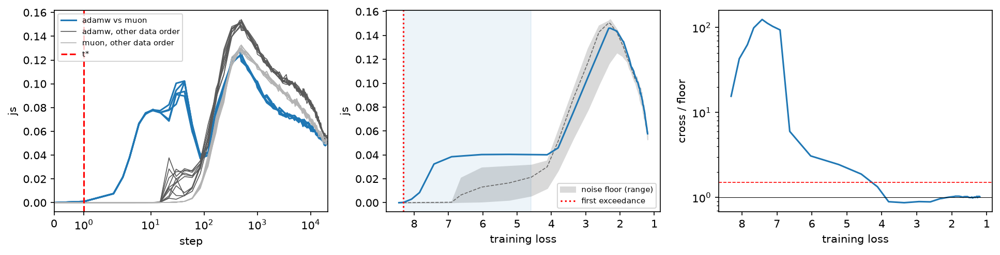

- TinyStories 30M, AdamW vs Muon: up to ~100× the floor at loss 8 → 6, ≈ 1× from loss 4 on. **No split.**
- Same in all 9 pairs (3 settings × 3 pairs): big early gap, back to ≈ 1×. Only exception: Shakespeare
  Muon vs SGD, slightly above the floor from loss 2.8 (where SGD stalls).

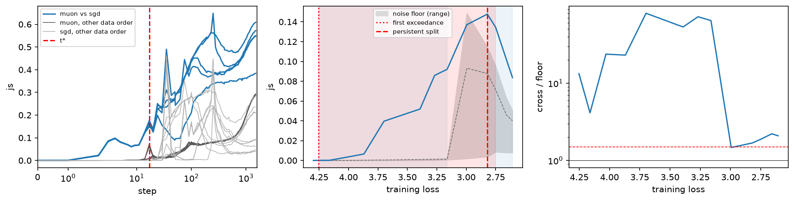

**[extra] Why they meet:** all optimizers pass through the **bigram model** (Shakespeare loss 2.47,
TinyStories ≈ 3.8). AdamW and SGD also pass the unigram model; Muon skips it.

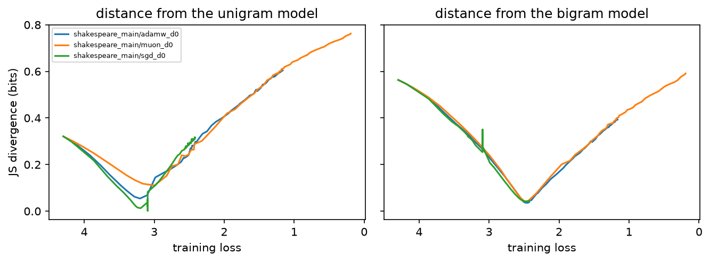

**[extra] Optimizer vs data order, at equal steps** (blue: other optimizer, same data; greys: same
optimizer, other data):

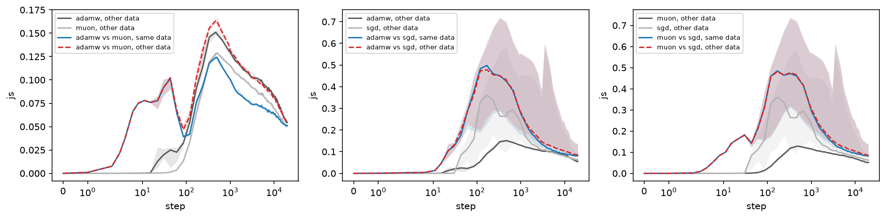

- AdamW vs Muon at the end of 30M: all ≈ 0.05 bits. Optimizer ≈ data order.
- vs SGD: 0.08 vs 0.06 — SGD ends elsewhere, but it is also slower (loss 1.37 vs 1.20).

## 3. [planned] What coincides with the changes: edge of stability, warmup, anatomy

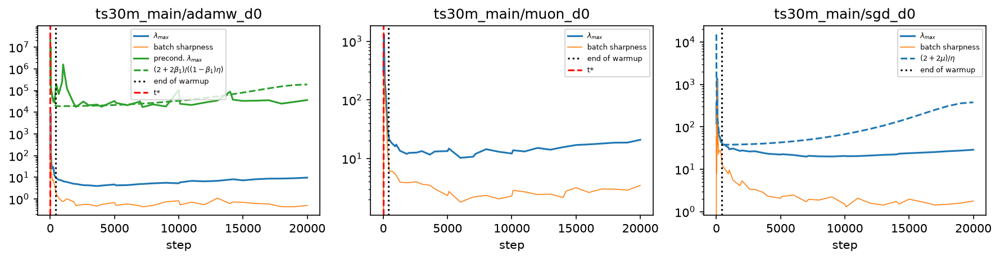

- AdamW: preconditioned sharpness on its threshold for most of training (adaptive EoS).
- SGD: on its threshold only around the end of warmup.
- The early episodes end within warmup (steps 9–85), the same way for AdamW–Muon (no SGD involved).
  → No EoS event lines up with them. Best description: a *stage of learning* (bigram), not a step.

**[planned] Anatomy of the sharp direction:**

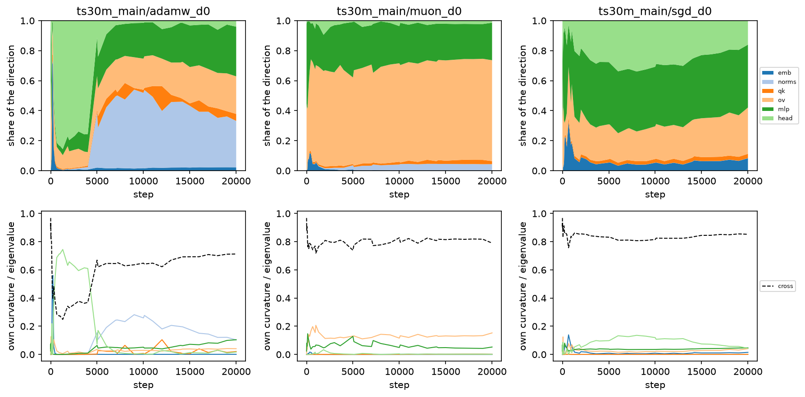

- Differs by optimizer: Muon → value/output matrices (TinyStories) or embeddings (Shakespeare); AdamW → head
  or norms.
- 70–85% of the top eigenvalue comes from **curvature between blocks**, not inside one.
- Changes of the dominant block happen long after the optimizers have re-met. No link to the split.

**[extra] Muon's embeddings at the edge of stability (Shakespeare):** Muon leaves embeddings/head/norms to
an Adam. Sharpness of that block over its threshold:

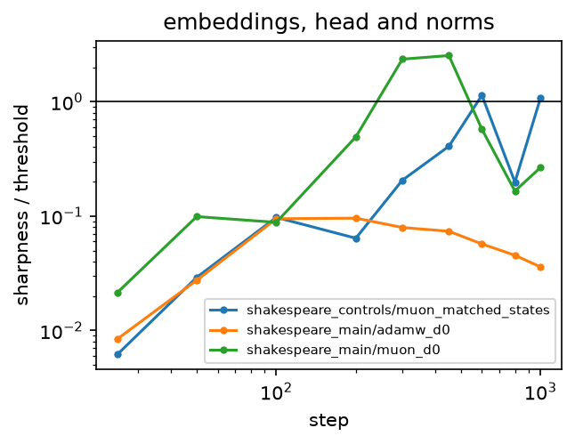

- Muon's block goes 2.5× over at steps 300–450, right before Muon memorizes. AdamW's stays ≤ 0.1×.
- **[extra] Control:** Muon with that Adam matched to AdamW (lr 3e-4). It still memorizes, and its block
  still crosses (1.1×, later). So Muon's hidden-matrix updates make the embeddings sharp; the lr only
  changes when.
- On 30M it's AdamW's block that overshoots (2.1×) — it has the larger lr there.

## 4. [planned] Swaps: train with A until step t, then switch to B (TinyStories 10M)

Fork's distance to each pure run, in units of the noise floor (solid: to the new optimizer, dashed: old).

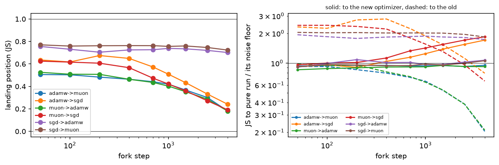

- AdamW ↔ Muon: within the floor of **both** pure runs at every switch step. Nothing to tell apart.
- SGD → AdamW/Muon: lands on the new optimizer even after 4000 SGD steps. SGD leaves no trace.
- AdamW/Muon → SGD: switches up to step 200 land on SGD; from step 1500 on they end closer to the old
  optimizer — SGD is too slow to undo it.
- Shakespeare (`figures/shakespeare/swap.png`): Muon is the fast one. Anything → Muon lands on Muon;
  Muon → AdamW/SGD keeps Muon's mark; SGD → AdamW keeps SGD's (AdamW at 3e-4 is slow there).
- 30M (`figures/ts30m/swap.png`): same, except switches into SGD land near SGD up to step 3000 (SGD's lr
  is 3× higher there).
- Rule: **the last optimizer decides the function if it's fast enough to get there in the steps left.**

**[planned] Linear mode connectivity** (loss barrier, parent's final weights vs fork's final weights):

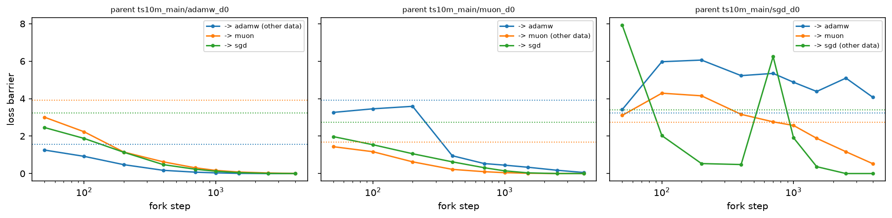

- Same optimizer, other data: one basin if forked after step ~1000 (10% of training).
- Other optimizer: needs a later fork (~2500–4000). SGD → AdamW: never.
- AdamW → Muon fork at step 1000: function within noise of both, but barrier 0.17 to its parent vs 0.035
  for a data-order fork. **The optimizer leaves a mark in weight space, not in function space.**
- Shakespeare (`figures/shakespeare/lmc.png`): same, except Muon itself is unstable to the data order until
  step ~800 (it's memorizing).
- 30M (`figures/ts30m/lmc.png`): same. SGD with other data is connected already at step 100: its data-order
  chaos is all in the first 100 steps.

**[extra] Do swaps end in the new optimizer's basin?** Barrier between pure B and every fork into B:

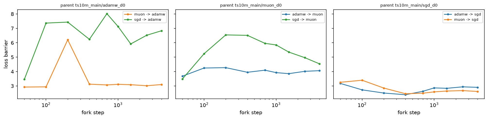

- **No, never** — not even when switching at step 50. Forks into AdamW/Muon are 3–8 nats away from pure
  AdamW/Muon, more than two data orders from init (1.6). Yet in function space they land right on B.
- So 50 steps of another optimizer moves the endpoint further in weight space than reshuffling all the data,
  while leaving no trace in the function.
- 30M: same for forks into Muon; into AdamW only partly (AdamW's own data orders are 3.3–6.8 apart there).
  Forks into SGD stay within SGD's own (large) data-order barriers.

**[extra] Barriers between pure runs, all pairs** (all = full barrier; then one block at a time moved from
run A to run B; mean ± sd over 5 optimizer pairs or 10 data-order pairs):

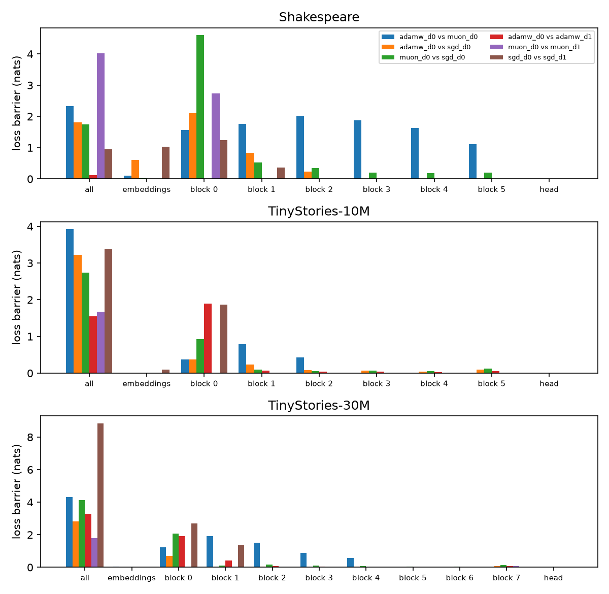

- **Size doesn't single out the optimizer.** AdamW vs Muon > data orders only on 10M (3.8 vs 1.5–1.7). On 30M
  AdamW's own data orders are as far (3.3–6.8), on Shakespeare Muon's (3.6–6.6). (I first had one pair per
  kind and over-claimed this; the all-pairs run corrected it.)
- **Location does.** Data orders: barrier only in the **first block** (or nowhere). AdamW vs Muon: also in the
  **middle blocks** (1–2 on 10M, 1–4 on 30M, 1–5 on Shakespeare). Pairs with SGD look like data orders.

## 4b. [planned] Function metrics (TinyStories, final, mean of 5 data orders)

| 10M | SGD | AdamW | Muon |
|:--|--:|--:|--:|
| moved from init (× init norm) | 0.4 | 2.7 | 5.0 |
| ℓ∞ / ℓ2 (×1000; small = even entries, Adam's bias) | 42 | **7.9** | 3.8 |
| stable rank of hidden matrices (big = even singular values, Muon's bias) | 56 | 41 | **75** |
| input Jacobian | 132 | 22 | 12 |
| token-substitution sensitivity | 0.07 | 0.08 | 0.07 |
| accuracy | 0.58 | 0.65 | 0.66 |

- Raw norms just track how far each optimizer moves the weights (Muon ≫ AdamW ≫ SGD).
- Scale-free: AdamW's entries are more even than SGD's, Muon's singular values are the most even — **each
  optimizer's geometry shows up in the weights**, even though AdamW's and Muon's functions are within noise.
- SGD's huge input derivatives are mostly scale (its embeddings stay small); substitution sensitivity is
  the same for all three.

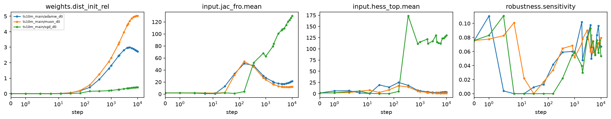

- Shakespeare: AdamW (lr 3e-4) barely leaves the init (0.25×) and has SGD's ℓ∞/ℓ2 — the bias only shows once
  the weights move. Muon again has the most even singular values.

**[extra] Representations** (linear CKA of hidden states; solid: other optimizer, dashed: other data):

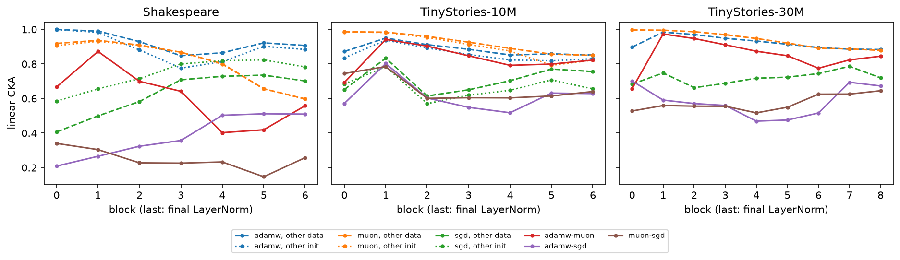

- TinyStories: AdamW vs Muon slightly less similar than two data orders (mostly in the first block).
- SGD isn't even reproducible across its own data orders. Shakespeare: AdamW and Muon clearly differ.
- Ladder: **weights** (clear mark) → **representations** (small mark) → **outputs** (none, even off-distribution).

**[planned] Metrics under swaps** (0 = like the old optimizer, 1 = like the new; ℓ∞/ℓ2 and stable rank are
[extra]):

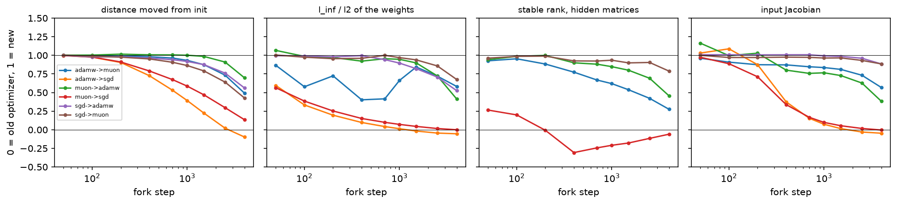

- The weights follow **whoever moved them more**, not whoever decides the function.
- X → SGD (switch ≥ 400): function ≈ SGD's, but weights keep the old optimizer's ℓ∞/ℓ2 and Jacobian.
- AdamW ↔ Muon late switches: functions identical, weights a mixture (stable rank only 0.3–0.45 of the way).
  **The weights remember the training history; the function doesn't.**
- 30M (`figures/ts30m/swap_metrics.png`): same; X → SGD keeps the old ℓ∞/ℓ2 from switch step 800.

**[extra] Off the data distribution** (final functions on validation text, the same text with shuffled
tokens, and random tokens; distance between optimizers ÷ distance between data orders):

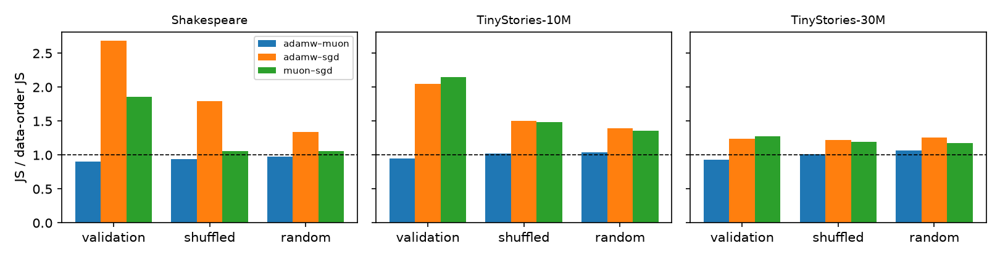

- Off-distribution every pair of runs differs 4–7× more, but AdamW vs Muon stays at **0.9–1.07×** the
  data-order distance everywhere. No hidden optimizer bias in how they extrapolate.
- SGD's gap (at equal steps) shrinks off-distribution: it's about fitting the data less, not extrapolating
  differently.

## 5. [planned] Break-even replication (CIFAR-10, plain SGD)

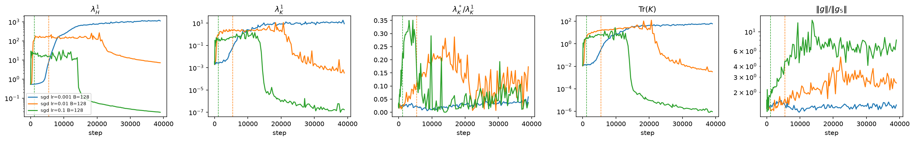

- Replicates: larger lr → lower sharpness (≈ 2/η) and better-conditioned gradient noise; runs share a path,
  then the large lr leaves first.
- **But** at equal loss, lr 0.01 vs 0.1 are only 1.0–1.75× the floor (0.001 vs 0.01: up to ~2×). The
  "separation" is speed.

**[extra] Transfer and batch size:**
- TinyStories 10M, lr 0.03/0.1/0.3: sharpness and noise effects replicate (not the noise conditioning). At
  equal loss: 150× early, 1× from loss 4 — the optimizer story again.
- Shakespeare: SGD without warmup blows up for ~10 steps; no split between rates.
- CIFAR batch 30 vs 300: smaller batch → lower sharpness (12 vs 50); at equal loss median 1.2×, no split.

## 6. [extra] Robustness of "no split"

Re-ran with top-1 disagreement, margin 0.25/1.0, run length 2/5, matching tolerance 1%/5%.

- TinyStories (both sizes) and Shakespeare AdamW–Muon: no split under **any** variant.
- Shakespeare Muon–SGD: gone under 3 of 7 variants → weak.

## 7. [extra] Second initialization

Same runs from another init (2 data orders). Distance to the same optimizer from **another init** (green)
vs **another data order** (grey) vs other optimizers (dashed), at equal steps:

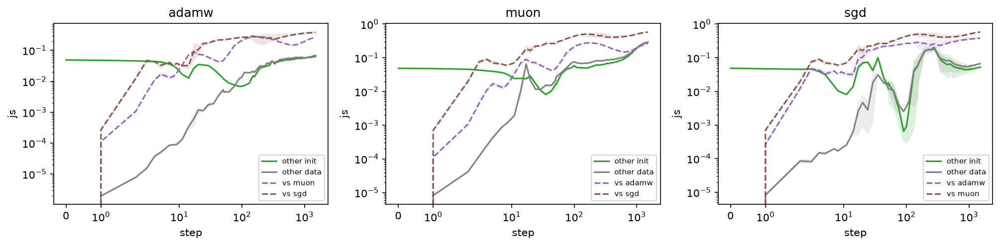

- After ~100 steps, changing the init ≈ changing the data order. The data-order floor is a fair noise floor.
- TinyStories 10M, end of training: other init 0.054, other data 0.062, AdamW↔Muon 0.058 bits. **Init, data
  order and optimizer all move the function by the same amount.**
- The split analysis replicates almost exactly: AdamW–Muon episodes 4.18–2.86 and 2.41–2.02 (init 0:
  4.23–2.77, 2.30–2.12), no split; Muon–SGD again slightly above the floor from loss 2.80 (init 0: 2.82).
  TinyStories 10M: same episodes, no split.

## 8. [extra] Rare vs frequent tokens

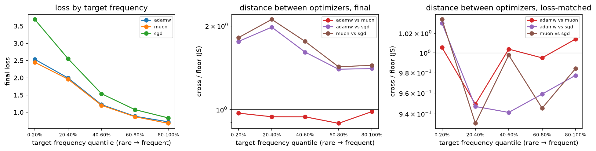

- SGD's loss gap is mostly on **rare** tokens (10M: +1.16 nats rarest fifth vs +0.11 most frequent), as
  Kunstner et al. (2024) predict.
- At equal loss: ≈ 1× the floor in every bin. SGD is slower on rare tokens, not different.

## 9. [extra] Positive control: a case where theory says they *should* split

Logistic regression on separable data: GD → ℓ2 max-margin, Adam → ℓ∞ max-margin.

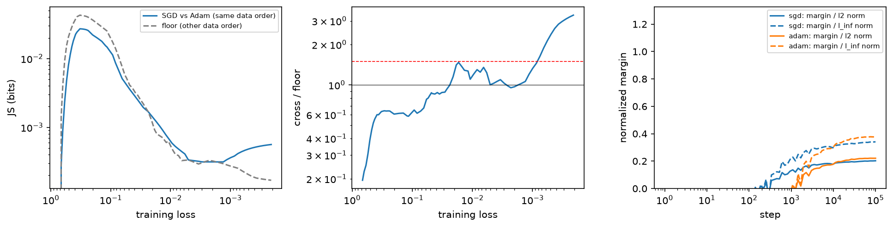

- Same detector: within the floor for most of training, then a **persistent split** below loss ~1e-3. The
  method can find a split — but it comes near interpolation, which the language models never reach.

## 10. [extra] Train until memorization (Shakespeare, 8000 steps)

Does the split just come later, near interpolation, like in the linear model? AdamW and Muon trained 8000
steps (AdamW train loss 0.09, val 4.6 — fully memorizing):

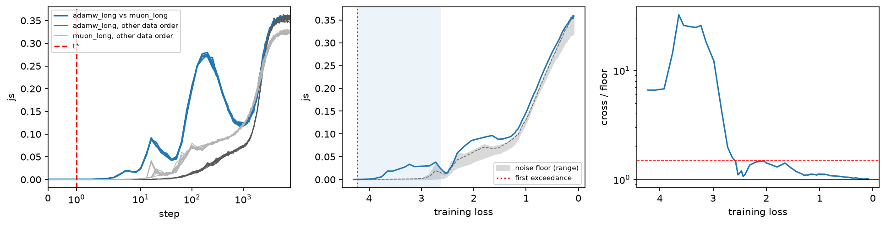

- Ratio → **1.0** all the way down to loss 0.09. No split, with JS or with disagreement.
- At the end: AdamW vs Muon 0.36 bits = two data orders (0.36 / 0.32). They memorize *differently*, but no
  more differently than reshuffling the data.

## 11. [extra] Other learning rates

Every lr-sweep run vs the tuned run of each optimizer (same data), at equal loss, ÷ floor (below the bigram loss):

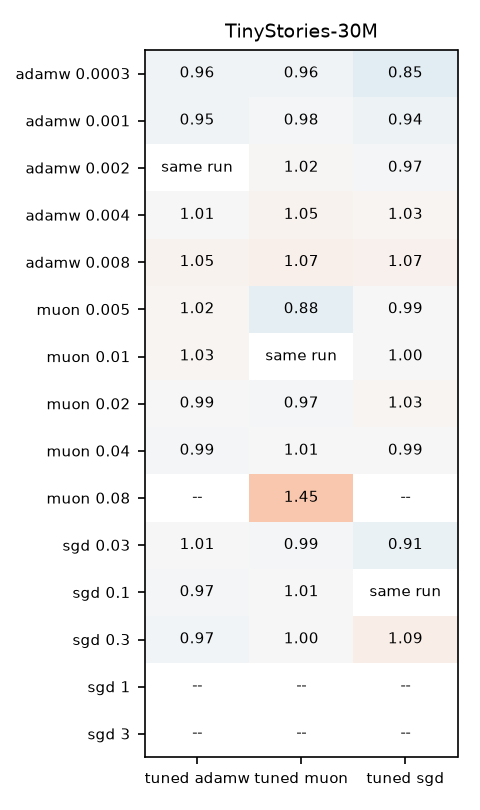

- TinyStories: **every stable lr** (27× range for AdamW, 8× Muon, 3–10× SGD) is within ~1× of all three tuned
  optimizers. Only lrs about to diverge stand out.
- So "no split" isn't an artifact of the chosen lrs.
