# Walkthrough: when do SGD, AdamW and Muon split?

Status: **in progress** (runs going on ORCD). Figures in `figures/`.

## 1. Learning-rate sweeps

One run per learning rate, same init and data order. Picked the best validation loss per optimizer.

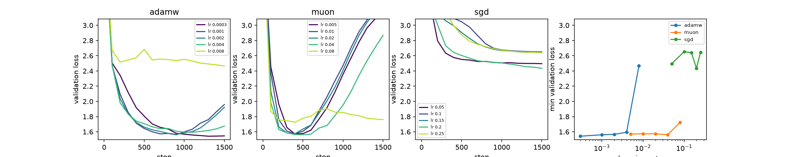
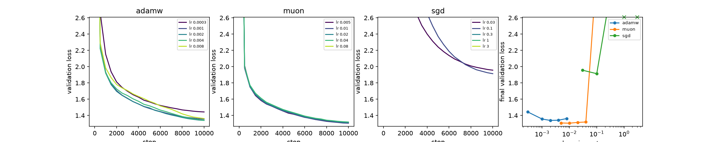
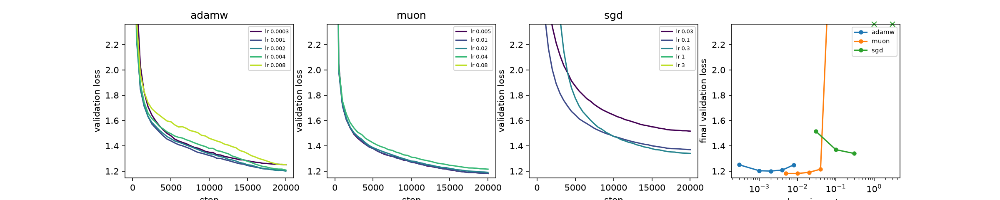

| | SGD | AdamW | Muon |
|:--|:--|:--|:--|
| Shakespeare (min val) | 0.2 → 2.44 | 3e-4 → 1.54 | 0.04 → 1.56 |
| TinyStories 10M (final val) | 0.1 → 1.91 | 2e-3 → 1.34 | 0.01 → 1.30 |
| TinyStories 30M (final val) | 0.3 → 1.34 | 2e-3 → 1.20 | 0.01 → 1.18 |

- Muon < AdamW < SGD everywhere. SGD is far behind on small models (Shakespeare: stuck near bigram loss).
- Shakespeare overfits without dropout; Muon overfits fastest (best at step ~500, then val loss climbs).
- SGD's best rate on order 0 was unstable on other orders everywhere (diverged or blew up), so SGD uses
  one grid step lower: Shakespeare 0.05, 10M 0.03, 30M 0.1.

## 2. Shakespeare: AdamW vs Muon (5 data orders each)

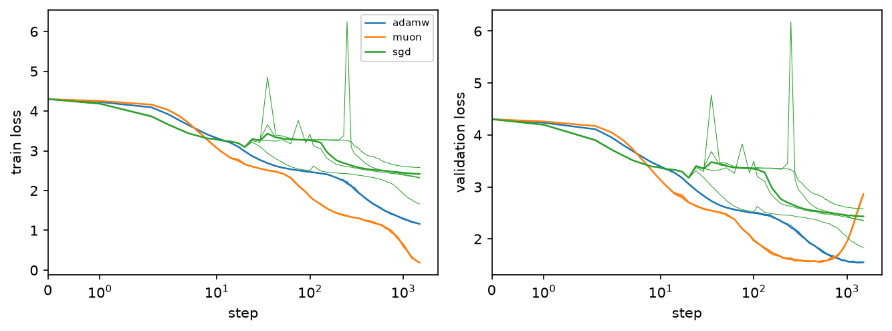

Muon learns faster and memorizes (val loss 1.56 at step ~500, then 2.86 at the end); AdamW (3e-4) does not.

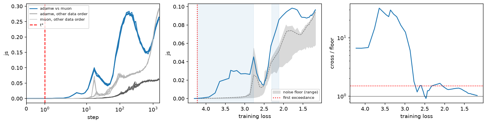

Right panel = AdamW–Muon distance divided by the seed-to-seed distance, at equal training loss.

- Early (loss 4.2 → 2.8): 10–30× the noise floor. They differ right away.
- At loss ≈ 2.5 they **meet again** (ratio ≈ 1).
- After that: only 1.3–1.6× the floor, back to 1× at the end. No lasting split.

Why they meet: both pass through the **bigram model** at loss 2.47 (JS ≈ 0.04 bits). AdamW also passes
near the unigram model; Muon skips that stage. So the early difference is the route, not the destination.

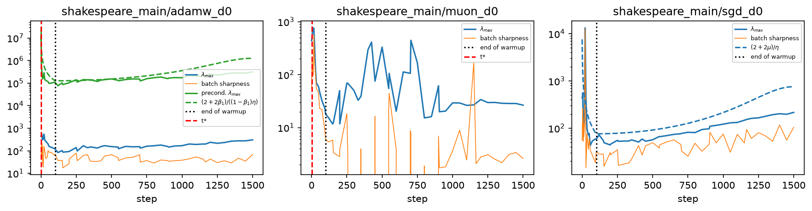

- AdamW: preconditioned sharpness sits on its stability threshold from the start until ~step 600, then the
  cosine decay lifts the threshold away (adaptive edge of stability, as in Cohen et al. 2022).
- Muon: no threshold to compare with; raw sharpness jumps around (10–400).

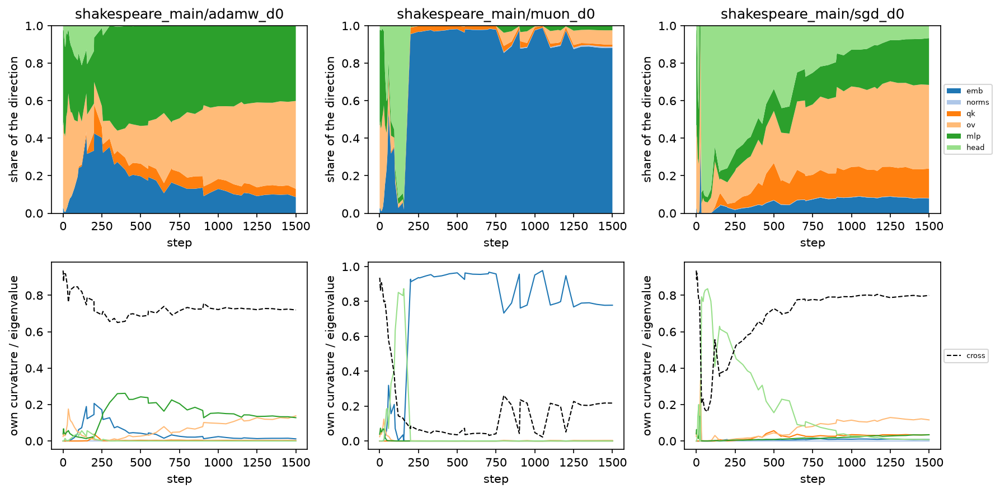

- Muon: the sharpest direction lives in the **embeddings** (~95%) — the part Muon leaves to its AdamW.
- AdamW: spread over MLP, value/output and embeddings; ~70% of the curvature comes from **cross-block**
  terms.

**With SGD** (it only gets down to loss ≈ 2.65 here, so the comparison stops there):

- Muon vs SGD: the only **lasting split** we found anywhere, from loss ≈ 2.8 on (96% of bootstraps).
- AdamW vs SGD: same early gap, then 1.3–1.7× the floor — borderline, not counted as a split.
- SGD's own seed-to-seed distance is erratic (spikes in the left panel): SGD at 0.05 is barely stable.

**Is Muon's embedding direction at the edge of stability?** Muon leaves embeddings/head/norms to a
plain Adam (lr 1e-3). Restricting the sharpness to those parameters:

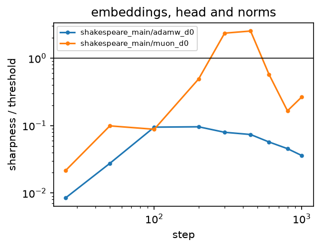

- Muon's Adam part goes **2.5× over** its stability threshold at steps 300–450, right before Muon starts
  to memorize (val loss minimum at step ~500). AdamW's embeddings stay at ≤ 0.1×.
- But it doesn't cause the memorization. Control: Muon with its Adam matched to AdamW (lr 3e-4, betas
  0.9/0.99, wd 0.1), 5 data orders. It still memorizes (train 0.22, val 2.5 vs AdamW's 1.55), so that comes
  from Muon's hidden-matrix updates.
- The control is indistinguishable from the original Muon (no split vs Muon, 4% of bootstraps), and it
  still re-converges with AdamW by the end (ratio → 1.07):

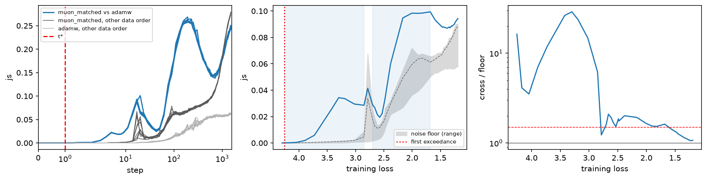

## 3. TinyStories 30M: AdamW vs Muon (5 data orders each)

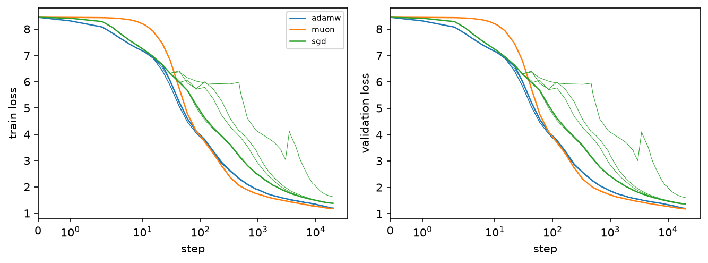

Muon starts slower (flat for ~10 steps), then is fastest; final val 1.18 (Muon), 1.20 (AdamW), 1.37 (SGD).

- Same story as Shakespeare, clearer: AdamW and Muon differ up to ~100× the floor at high loss (8 → 6), and
  the ratio falls to ≈ 1 by loss 4. **No lasting split.**
- Left panel: from step ~200 on, AdamW and Muon *on the same data order* are closer than two AdamW runs
  on different data orders. **Data order matters more than the optimizer.**

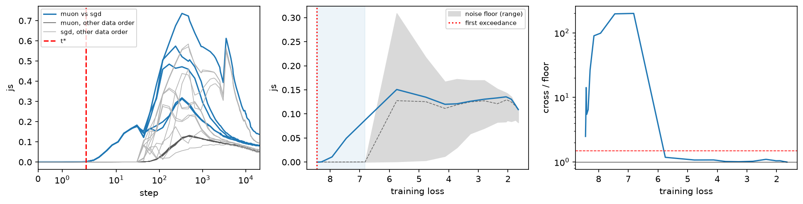

- With SGD: same pattern (10–200× early, ≈ 1× after loss 6). But SGD's own seed-to-seed distance is huge
  (light grey, up to 0.6 bits), so "no split" here means "no bigger than SGD's own noise".

**Optimizer vs data order, at equal steps** (blue = other optimizer on the same data, red = other
optimizer on other data, greys = same optimizer on other data):

- AdamW vs Muon at the end: all four ≈ 0.05 bits. **Swapping AdamW for Muon changes the final function
  no more than reshuffling the data.** Sharing the data order makes them ~20% closer mid-training.
- vs SGD: 0.08 bits against floors 0.055–0.063, and same ≈ other data. SGD does end somewhere else, but at
  equal steps that is partly because it is slower (loss 1.37 vs 1.20).
- Shakespeare (`figures/shakespeare/decompose_js.png`) is the opposite at equal steps: the optimizer
  dominates (0.26 vs AdamW floor 0.06), because Muon is far ahead in memorizing.

**Embedding-block EoS on 30M:** reversed from Shakespeare — here AdamW's embeddings overshoot (2.1× at the
end of warmup, step 400), Muon's Adam stays ≤ 0.53×. In both settings the overshooting one is whichever
Adam has the larger lr on the embeddings (Shakespeare: Muon's 1e-3 > 3e-4; 30M: AdamW's 2e-3 > 1.5e-3).
So it's a learning-rate effect, not a Muon effect.

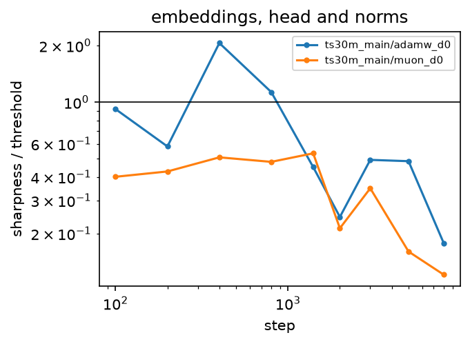

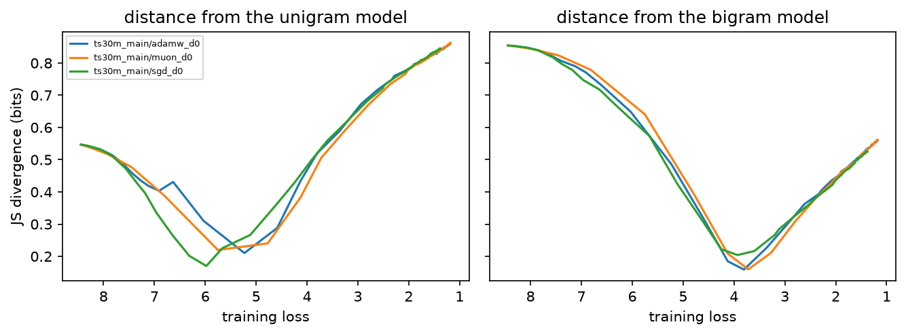

All three optimizers (SGD too) pass through the bigram model at loss ≈ 3.8.

- AdamW: preconditioned sharpness on its threshold from warmup to ~step 10k (then LR decay lifts it).
- SGD: λ_max sits on 3.8/η only around the end of warmup (steps 60–660), then stays below.

- Unlike Shakespeare, Muon's sharp direction is in the value/output matrices (60–70%), not the embeddings.
- AdamW: head early, then the norms (30–50%). SGD: MLP + value/output + head.
- In all three, 70–85% of the top eigenvalue comes from **cross-block** curvature.

## 3b. TinyStories 10M: same story

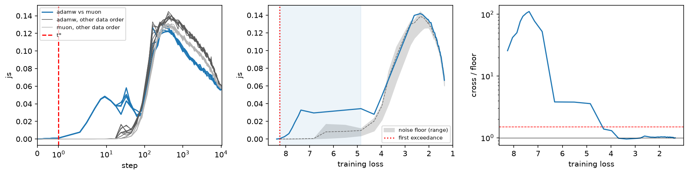

- Final val: Muon 1.31, AdamW 1.34, SGD 1.77–1.96 (SGD at 0.03 varies a lot by data order).
- End of training, equal steps: AdamW vs Muon 0.057 bits = the floors (0.058–0.061); vs SGD 0.14 (SGD is
  far behind in loss).
- Every pair: big early gap (up to 100×), back to ≈ 1× by loss 4–6. **No lasting split**, again.
- EoS: AdamW on its threshold until step ~5–10k; SGD only around the end of warmup (≈ 10% of measurements).
- Anatomy: Muon's sharp direction in value/output again (60–70%); AdamW's mostly in the **head** (60–75%,
  vs norms on 30M).

## 4. Break-even replication (Jastrzebski et al. 2020): plain SGD, different learning rates

**CIFAR-10 SimpleCNN, lr 0.001 / 0.01 / 0.1:**

- Replicates: a larger lr caps the sharpness lower early (λ_H peaks ≈ 1000 / 200 / 20 ≈ 2/η each) and gives a
  better-conditioned gradient noise (λ*_K/λ_K higher). 

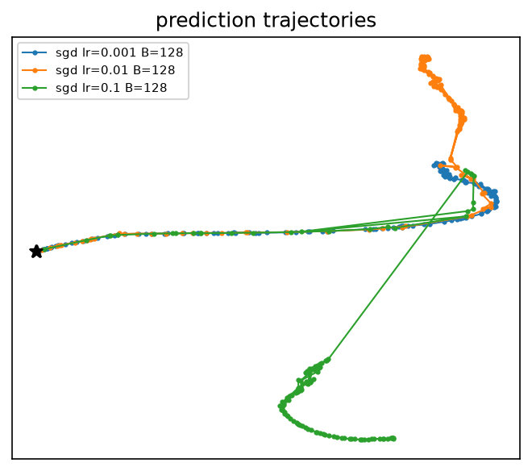

- Replicates: the three runs share a path, then lr 0.1 leaves first, then 0.01.

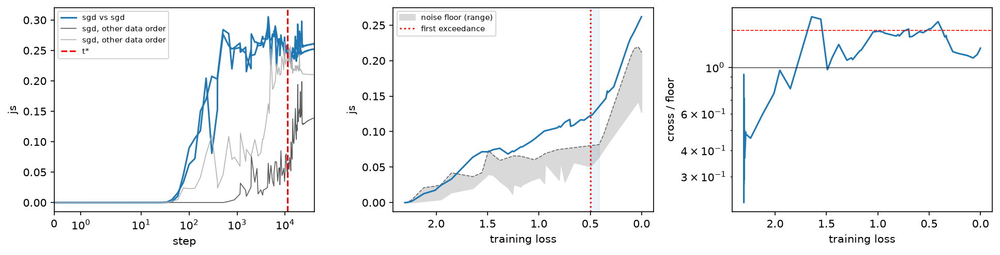

- **But**: at equal *training loss*, lr 0.01 and 0.1 are only 1.0–1.75× (median 1.24) the data-order floor. Most of the
  step-time "separation" is one run being faster. Same lesson as for the optimizers.

**Shakespeare transformer, lr 0.1 / 0.3:** plain SGD without warmup blows up for ~10 steps (JS → 1),
recovers, and only reaches loss ≈ 3.1. No difference between rates beyond data-order noise.

## 5. Is "no lasting split" robust?

Re-ran the split detection with top-1 disagreement instead of JS, margin 0.25/1.0 (default 0.5),
run length k = 2/5 (default 3), loss-matching tolerance 1%/5% (default 2%).

- Shakespeare AdamW vs Muon: no lasting split under **any** variant.
- Shakespeare Muon vs SGD: the lasting split is **fragile** — gone with disagreement, with margin 1.0, or
  with k = 5. Treat it as "SGD sits slightly off, barely above noise", not a clear split.
- TinyStories 10M and 30M: no lasting split for any pair under any of the 7 variants.

## 6. [extra] Rare vs frequent tokens

Probe positions binned by how frequent the target token is (quintiles, rare → frequent).

- SGD's loss gap is mostly on **rare** tokens (10M: +1.16 nats on the rarest fifth vs +0.11 on the most
  frequent; 30M: +0.48 vs +0.07), as Kunstner et al. (2024) predict for SGD vs Adam.
- At equal steps, SGD's distance from AdamW/Muon is largest on rare tokens (1.8–2.1× floor vs 1.4×).
- At **equal loss** it's ≈ 1× the floor in every bin, for every pair. So the rare-token gap is SGD being
  slower on rare tokens, not learning a different function there.

## 7. [extra] Positive control: a case where theory says they *should* split

Logistic regression on separable data: GD → l2 max-margin, Adam → l_inf max-margin (known limits).

- Same detector, same thresholds: within the floor for most of training, then a **persistent split** below
  loss ~1e-3 (ratio up to 3×). So the method can find a split; in the linear case it also comes late,
  near interpolation — a regime our language models never reach.

## 8. CIFAR batch size (break-even, B = 30 vs 300 at lr 0.05)

- Replicates: smaller batch → lower sharpness (λ_H ≈ 12 vs ≈ 50).
- At equal loss: median 1.2× the floor (0.7–2.1), no split.

**TinyStories 10M, SGD lr 0.03 / 0.1 / 0.3:** larger lr → lower sharpness (λ_H ≈ 125 / 35 / 20) and lower
gradient noise (Tr K), as predicted; the noise conditioning (λ*_K/λ_K) does *not* improve with lr here.
At equal loss: up to ~150× the floor at loss 7.5, back to 1× by loss 4 — the optimizer story again.

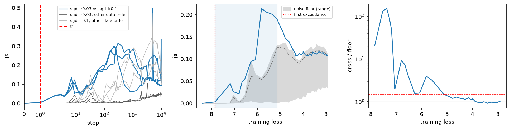

## 9. Swaps: train with A until step t, then switch to B (TinyStories 10M)

Each fork vs the pure runs, in units of the data-order noise floor (solid: to the new optimizer, dashed: to
the old one).

- AdamW ↔ Muon: the result is within the floor of **both** pure runs at every switch step — nothing to tell
  apart.
- SGD → AdamW/Muon: lands on the new optimizer (≈ 1 floor) even after 4000 SGD steps. SGD leaves no trace.
- AdamW/Muon → SGD: early switches land on pure SGD; later ones stay near the old optimizer, because SGD is
  too slow to move away from what was already learned.

**Linear mode connectivity:** loss barrier between the parent's final weights and the fork's final weights.

- Same optimizer, other data order: in one basin if forked after step ~1000–1500 (barrier < 0.05).
- Other optimizer: needs a later fork (AdamW parent: ~2500–4000). Muon → AdamW still 0.05 at 4000.
- SGD parent → AdamW: **never** connected (barrier 4–6 nats), although in function space that fork lands
  right on AdamW. **Same function, different basin.**
- Dotted: pure runs (only the init shared): barrier 1.6–3.9, as expected.
